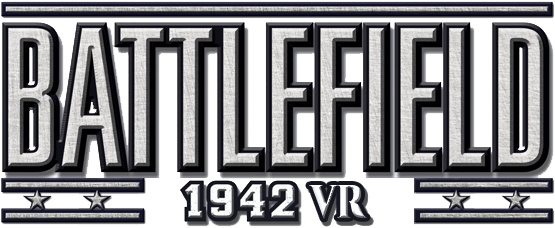

# BFVR

BFVR (now on version 1.0.3) adds stereoscopic VR rendering, tracked-controller aiming, VR menus, and
VR comfort and graphics options to Battlefield 1942.

The normal player version is launched by double-clicking `BFVR.exe`. It does
not need a batch file and it does not replace `BF1942.exe`. BF42++ is a
separate prerequisite, although some community Battlefield packages already
include it.

## Requirements

- A working, installed copy of Battlefield 1942 on 64-bit Windows 10
  or Windows 11.
- A PC VR headset and an active OpenXR runtime, such as Meta Quest Link,
  SteamVR, or Virtual Desktop's VDXR runtime.
- A Battlefield 1942 installation containing `BF1942.exe`.
- [BF42++] ( https://www.moddb.com/games/battlefield-1942/addons/bf42plusplus-v2-0-rc6 )
  or a newer compatible release. BF42++ may be installed as its
  separate `bf42++.dll`, or may already be included by a community game
  package as a recognized `dsound.dll` proxy. BF42++ is not included with
  BFVR. Do not add a second copy when a package already includes it. If both
  are present, BFVR 1.0.3 selects the recognized bundled proxy and does not
  inject the extra `bf42++.dll`.

BFVR 1.0.3 supports BF42++ 2.0's `fixAnimatedMeshLighting` shader change; you
do not need to disable that feature for BFVR.

BFVR can apply head orientation to Battlefield's DirectSound 3D listener
without installing or replacing the game's `dsound.dll` or DSOAL files.
Battlefield's DirectSound3D/hardware audio path must be enabled; HRTF still
depends on the audio backend already installed and configured for your game.
`head_tracked_audio_enabled` defaults to `true` and can disable the listener
correction. `head_tracked_audio_position_enabled` optionally tracks head
position and defaults to `false`; both settings are in `UserConfig.txt`.

BFVR has worked with several substantially different retail, digital, and
community-modified Battlefield packages in real testing. It does not block an
unfamiliar executable. A specific untested build may still be incompatible
because some BFVR features connect to internal game code.

For the easiest currently supported setup, the Moongamers Battlefield 1942
versions are recommended. BFVR is planned to eventually be bundled with the
Battlefield 1942 VKHD installers; until then, install BFVR separately using
the guide below. 

Recommended BF1942 Version: https://www.moongamers.com/forum/index.php?showtopic=67127
## Important: The recommended MoonGamers version already includes BF42++. Do not install BF42++ again. 
Simply install BFVR and launch BFVR.exe. Only install BF42++ separately for other BF1942 versions when BFVR reports that it is missing.

## Installing and playing

See [Installation](docs/INSTALLATION.md) for a beginner-friendly walkthrough.
After installation:

1. Connect the headset and start the OpenXR software you normally use.
2. Double-click the BFVR shortcut or `Battlefield 1942\BFVR\BFVR.exe`.
3. Choose a map using Battlefield 1942's normal menus.
4. Exit Battlefield 1942 normally when finished.

IMPORTANT: If Borderless1942 is installed, disable it using the Moongamers "Battlefield 1942 Options" tool. It can stop VR
presentation when Battlefield 1942 changes process during a map transition.
BFVR's `loader.log` and `BFVRPresenter-game.log` are saved beside `BFVR.exe`;
the presenter log identifies the active OpenXR runtime and headset/system when
the runtime provides that information.

See the [User Guide](docs/USER_GUIDE.md) for controls, settings, SteamVR setup,
troubleshooting, and uninstalling.

## Important safety information

BFVR loads its own DLL into the Battlefield 1942 process. That is how this mod
connects VR rendering and controls to an old game that has no mod API for these
features. Antivirus software may treat that technique cautiously.

The BFVR installer is intentionally unsigned, so Windows may display
"Unknown publisher." Only run an installer downloaded from this repository's
official GitHub Release page, and compare its published SHA-256 checksum when
in doubt.

BFVR does not bypass anti-cheat or server rules. Use it only where client-side
mods are permitted.

## Source and development

The source code, third-party source, tests, and developer diagnostics live in
this repository. They are not copied into the player installation. See
[Development](docs/DEVELOPMENT.md), the clearly labeled
[AI and Developer Handoff](docs/AI_DEVELOPER_HANDOFF.md), and the detailed
[development record](devREADME.md).

Third-party components and their licenses are listed in
[Third-Party Notices](THIRD_PARTY_NOTICES.md).

BFVR source is available under the [MIT License](LICENSE).

## Acknowledgements

Special thanks to 333hronos, Arkyliën, Notagameaddict, Meurtreetbanane,
Pande4360, SnickersDaBunny, Fearganainm, Myrothas, HeavyMetalGamer, whachusmokin, ZALIAS, _olku_, Irman, Casqade, and to the wider VR modding and Battlefield
modding communities.
